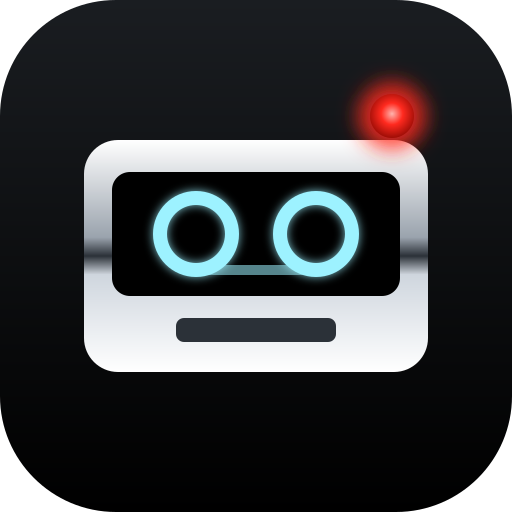
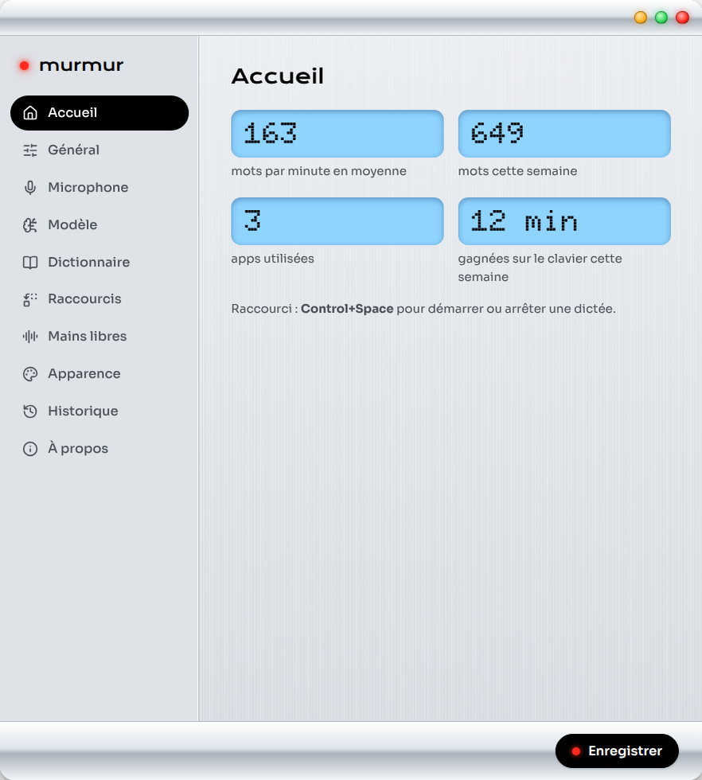
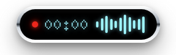
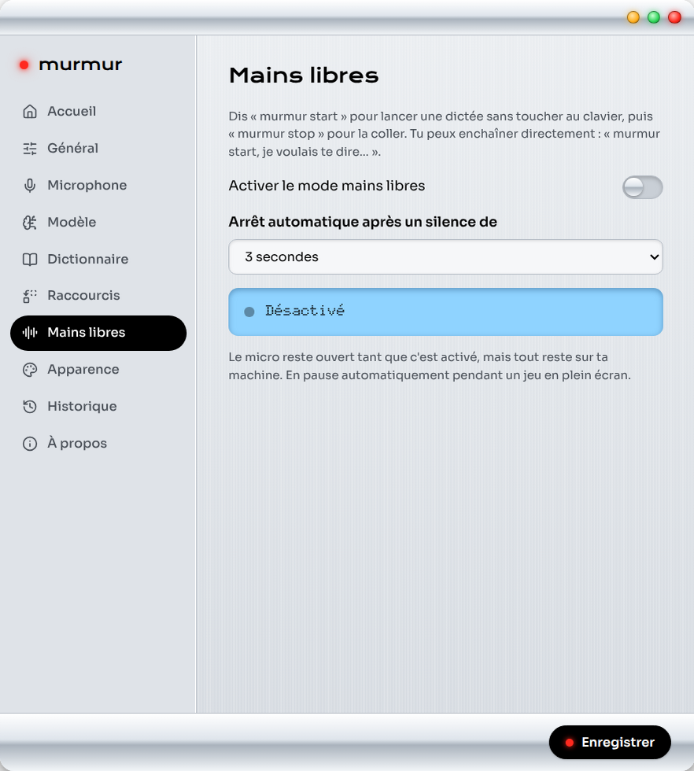
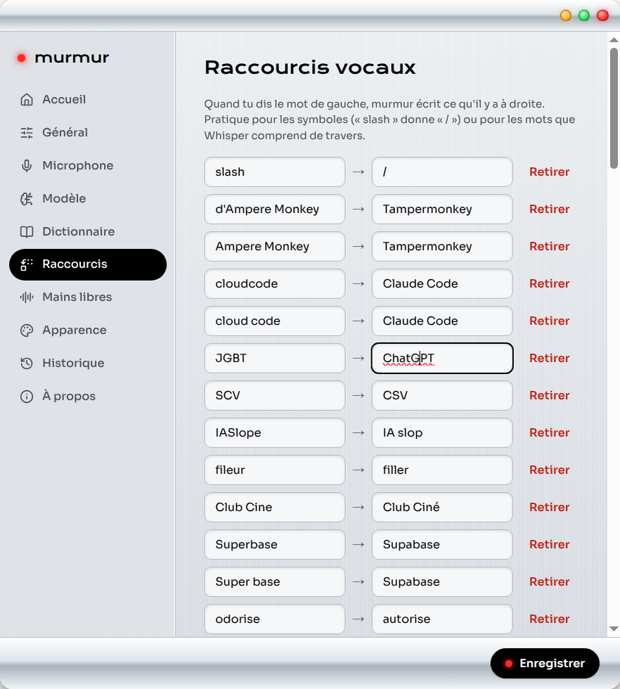

<div align="center">



# murmur

Dictée vocale privée, 100% locale, pour le français mêlé d'anglais.

[English](README.md) | **Français**

[](../../releases/latest)
[](../../releases/latest)
[](#sur-linux-kde-plasma)

<br />



</div>

<br />

J'en avais marre de taper au clavier pour tout, surtout quand un mot anglais se glisse au milieu d'une phrase en français et que le correcteur automatique s'en mêle. Alors j'ai fait murmur : un raccourci clavier, tu parles, le texte atterrit tout seul là où tu travailles. Whisper tourne sur ton propre GPU, rien ne sort de la machine.

## 🎙️ Ce qu'il y a dedans

Appuie sur `Ctrl+Espace`, une petite capsule chromée apparaît en bas de l'écran et t'écoute. Sur son écran, une LED rouge, le temps qui défile et ta voix qui passe syllabe par syllabe, même si t'es un peu loin du micro. Réappuie, elle transcrit et colle le texte à l'endroit où était ton curseur.

<div align="center">

</div>

Elle reconnaît le français avec des mots anglais mêlés dedans sans les traduire (« il faut update le README avant la deadline »), et tu peux lui apprendre tes propres termes techniques ou noms propres dans le dictionnaire.

Le texte arrive toujours suivi d'une espace, du coup tu peux enchaîner plusieurs dictées dans le même message sans que les phrases se collent.

> [!TIP]
> Si tu commences à parler pile en appuyant, active Réglages → **Microphone** → **Garder le micro ouvert**. murmur garde alors en mémoire la dernière fraction de seconde, sans rien enregistrer, et ton premier mot passe en entier.

## 🗣️ Mode mains libres

Plus besoin de toucher au clavier : dis « murmur start », un petit bip confirme que murmur t'écoute, puis parle. Pour finir, dis « murmur stop », ou tais-toi quelques secondes, et le texte se colle tout seul. Tu peux aussi tout enchaîner d'une traite : « murmur start, je voulais te dire… ».

<div align="center">

</div>

Ça s'active dans Réglages → **Mains libres**. Un voyant montre en direct si murmur t'entend, et la dernière phrase qu'il a comprise, pratique pour vérifier que « murmur start » passe bien. Le micro reste ouvert tant que le mode est activé, mais rien ne sort de ta machine : un petit détecteur de voix tourne en local, et seules les phrases dites près du micro passent par Whisper pour repérer la commande. Les voix au fond de la pièce sont ignorées, et en jeu plein écran, tout se met en pause.

> [!TIP]
> Avec un casque Bluetooth, garder le micro ouvert fait passer le son en qualité « appel téléphonique ». Ce mode est surtout fait pour un micro séparé (USB, micro du PC).

## 🔀 Raccourcis vocaux

Tu dis un mot, murmur en écrit un autre. Dis « slash usage » et tu obtiens `/usage`, pratique pour taper une commande sans toucher au clavier. Ça sert aussi à rattraper les mots que Whisper comprend toujours de travers : s'il entend « cloud code » à chaque fois, un raccourci le remplace par « Claude Code ».

<div align="center">

</div>

Tout se gère dans Réglages → **Raccourcis** : une ligne par raccourci, ce que tu dis à gauche, ce qui s'écrit à droite.

## 🏠 Un écran d'accueil qui compte pour toi

Vitesse moyenne, mots dictés cette semaine, apps utilisées, temps gagné par rapport à la frappe au clavier : tout ça se calcule tout seul, à partir de l'historique de tes dictées stocké en local, et s'affiche sur de petits écrans LCD.

Le reste des réglages s'ouvre avec un clic droit sur l'icône de la barre système → **Réglages** : raccourci clavier, choix du micro, modèle Whisper, dictionnaire personnel, position de la pastille, couleur de son écran et historique des dictées.

## 🌍 En français ou en anglais

L'interface existe en français et en anglais. Par défaut, murmur suit la langue de ton système, et tu peux la forcer dans Réglages → **Général** → **Langue de l'interface**. La dictée, elle, reste en français, y'a que les menus et les textes qui changent.

## 📥 Installation

1. Télécharge `murmur-Setup-x.x.x.exe` sur la [page des versions](../../releases/latest).
2. Double-clique dessus et suis l'installeur, il crée le raccourci sur le Bureau et dans le menu Démarrer.
3. Au premier lancement, murmur télécharge le modèle Whisper (575 Mo) et la pastille affiche où il en est. Une fois à 100 %, c'est parti avec `Ctrl+Espace`.

> [!NOTE]
> La première fois, Windows va sûrement afficher une fenêtre bleue « Windows a protégé votre ordinateur ». Il fait ça avec toutes les petites apps qu'il connaît pas encore. Clique sur « Informations complémentaires », puis sur « Exécuter quand même ».

> [!WARNING]
> Il faut un GPU NVIDIA (CUDA). Sans ça, la transcription pourra pas tourner.

### Sur Linux (KDE Plasma)

Il faut KDE Plasma 6 et le pilote NVIDIA. Colle cette commande dans un terminal :

```bash
curl -fsSL https://murmur.qyrn.dev/install.sh | sh
```

Elle installe les petits outils dont murmur a besoin (`wl-clipboard`, `ydotool`, `kdotool`, `ffmpeg`), range l'AppImage dans `~/Applications`, l'ajoute au menu et lance murmur. Elle te demande ton mot de passe pour les outils, et tu peux [lire le script](site/public/install.sh) avant.

Le raccourci s'enregistre dans les raccourcis globaux de KDE : tu le retrouves dans Configuration du système → Raccourcis → murmur. Dans un terminal, murmur colle avec `Ctrl+Maj+V` au lieu de `Ctrl+V`.

## 🔄 Les mises à jour

Quand je sors une nouvelle version, murmur la télécharge dans son coin et te propose de redémarrer pour l'installer. Si tu dis non, elle s'installera toute seule au prochain lancement. Ça marche pareil sur Windows et avec l'AppImage sur Linux, par contre si tu compiles murmur toi-même, c'est à toi de recompiler.

## 🔒 Et tes données ?

Tout tourne en local : l'audio quitte jamais ta machine, la transcription se fait sur ton GPU via [whisper.cpp](https://github.com/ggml-org/whisper.cpp), et l'historique des dictées reste dans un fichier sur ton disque (`history.json`). Aucun serveur à moi entre les deux, la seule connexion c'est le téléchargement du modèle depuis Hugging Face au premier lancement.

Avec le mode mains libres activé, murmur garde aussi les 500 dernières phrases qui ressemblent à « murmur start » ou « murmur stop », dans `voice-commands.json`. Elles servent à voir comment Whisper comprend tes commandes pour améliorer la reconnaissance. Le reste de ce que tu dis est jamais enregistré.

Tout ça se trouve dans `%APPDATA%\murmur` sur Windows et `~/.config/murmur` sur Linux, et tu peux supprimer ces fichiers quand tu veux.

## 🤔 Si ça coince

<details>
<summary><b>Le micro ne fonctionne pas</b></summary>
<br />
Sur Windows, vérifie dans Paramètres → Confidentialité et sécurité → Microphone que l'accès micro est autorisé pour les applications de bureau. Ensuite, dans Réglages → Microphone, clique sur « Détecter les micros disponibles » et choisis le bon.
</details>

<details>
<summary><b>Mon casque Bluetooth se déconnecte pendant la dictée</b></summary>
<br />
C'est le système qui bascule le casque du profil audio (A2DP) vers le profil mains-libres (HFP) dès qu'une app demande le micro, et certains casques gèrent mal cette bascule. Choisis un autre micro dans Réglages → Microphone.
</details>

<details>
<summary><b>La pastille affiche « ERREUR » juste après le démarrage</b></summary>
<br />
Le pilote GPU est pas toujours prêt au tout début, du coup le moteur de transcription démarre pas. murmur retente plusieurs fois tout seul (jusqu'à une trentaine de secondes). Sinon, clic droit sur l'icône de la barre système → « Réessayer de démarrer le moteur ». Le journal est dans <code>logs/main.log</code>, dans le dossier des données.
</details>

<details>
<summary><b>Ctrl+Espace lance rien quand je joue</b></summary>
<br />
C'est voulu : quand un jeu (ou n'importe quelle app) est en plein écran, murmur laisse le raccourci au jeu pour pas lancer une dictée par erreur. Tu peux couper ce comportement dans Réglages → Général.
</details>

<details>
<summary><b>Rien se colle dans l'app active</b></summary>
<br />
Sur Windows, les applications lancées en administrateur refusent les entrées clavier d'un programme normal. Lance murmur en administrateur aussi dans ce cas. Sur Linux, vérifie que <code>ydotool</code> tourne (<code>systemctl --user status ydotool</code>).
</details>

<details>
<summary><b>L'icône a disparu de la barre système</b></summary>
<br />
Sur Windows, elle se cache sûrement derrière la flèche <code>^</code> à côté de l'horloge. Fais-la glisser dans la barre des tâches pour la garder visible.
</details>

---

<details>
<summary>🛠️ <b>Pour bidouiller le code</b></summary>

<br />

Electron, electron-vite et TypeScript strict. Node 24+ et pnpm 10+.

### Prérequis

- GPU NVIDIA, CUDA Toolkit 12.8+
- CMake et Visual Studio 2022 Build Tools (workload « Desktop development with C++ ») sur Windows, CMake, Ninja et GCC sur Linux
- git, ffmpeg accessibles dans le PATH

### Commandes

```bash
pnpm install
./scripts/setup-whisper.ps1                          # clone + compile whisper.cpp avec CUDA (Linux : ./scripts/setup-whisper.sh)
./scripts/download-model.ps1 -Model large-v3-turbo   # Linux : ./scripts/download-model.sh large-v3-turbo
pnpm dev                                             # mode développement
pnpm typecheck
pnpm lint
pnpm build:win                                       # génère l'installeur dans dist/
pnpm build:linux                                     # génère l'AppImage dans dist/
node scripts/render-icons.mjs                        # régénère les icônes depuis resources/icons/*.svg
```

Pour publier une version : monte `version` dans `package.json`, lance `pnpm build:win` sur Windows et `pnpm build:linux` sur Linux, puis joins à la release GitHub les fichiers de `dist/` : l'installeur `.exe`, son `.blockmap` et `latest.yml` côté Windows, `murmur-x86_64.AppImage` et `latest-linux.yml` côté Linux. S'il en manque un, la mise à jour automatique verra pas la nouvelle version. Pour que l'AppImage tourne sur d'autres cartes que la tienne, compile whisper.cpp avant avec `CUDA_ARCHITECTURES="75;80;86;89;120" ./scripts/setup-whisper.sh --bundle-cuda-runtime`, ça embarque aussi les bibliothèques CUDA.

Pour refaire les captures du README : choisis la langue de l'interface dans les réglages, puis lance `MURMUR_SCREENSHOT=docs/fr pnpm dev` (ou `docs/en`). L'app photographie elle-même ses fenêtres (Accueil, Raccourcis, Mains libres, pastille) avec un faux micro, enregistre les PNG dans le dossier donné, puis se ferme.

| Dossier                 | Rôle                                                                             |
| ----------------------- | -------------------------------------------------------------------------------- |
| `src/main`              | barre système, raccourci global, moteur whisper-server, historique, mises à jour |
| `src/preload`           | ponts entre l'app et chaque fenêtre                                              |
| `src/renderer/recorder` | capture micro, niveau de la voix, mode mains libres (fenêtre cachée)             |
| `src/renderer/overlay`  | la pastille flottante                                                            |
| `src/renderer/settings` | la fenêtre Réglages                                                              |
| `src/shared`            | types, canaux IPC et textes de l'interface en français et en anglais             |
| `resources/icons`       | sources SVG des icônes de l'app et de la barre système                           |
| `site`                  | la page de présentation (Vite + TypeScript)                                      |
| `whisper-engine`        | whisper.cpp compilé + modèles (généré, pas versionné)                            |
| `scripts`               | compilation de whisper.cpp, téléchargement des modèles, rendu des icônes         |

</details>

## 🔏 Politique de signature du code (Code signing policy)

Free code signing provided by [SignPath.io](https://about.signpath.io), certificate by [SignPath Foundation](https://signpath.org).

- Contributeurs et relecteurs : [qyrn](https://github.com/qyrn)
- Approbateurs : [qyrn](https://github.com/qyrn)

Chaque installeur Windows est compilé depuis ce dépôt par [GitHub Actions](.github/workflows/release.yml), et chaque demande de signature est validée à la main.

Confidentialité : ce programme n'envoie aucune information à d'autres systèmes en réseau, sauf si l'utilisateur ou la personne qui l'installe ou l'utilise le demande. murmur se connecte uniquement pour télécharger le modèle Whisper depuis Hugging Face au premier lancement et, sur Windows, pour vérifier sur GitHub s'il y a une nouvelle version. Ta voix et ton texte ne quittent jamais ta machine.

## 📄 Licence

[MIT](LICENSE)
