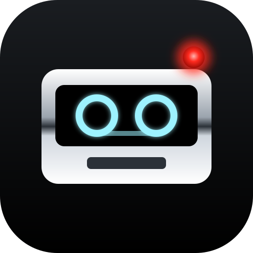
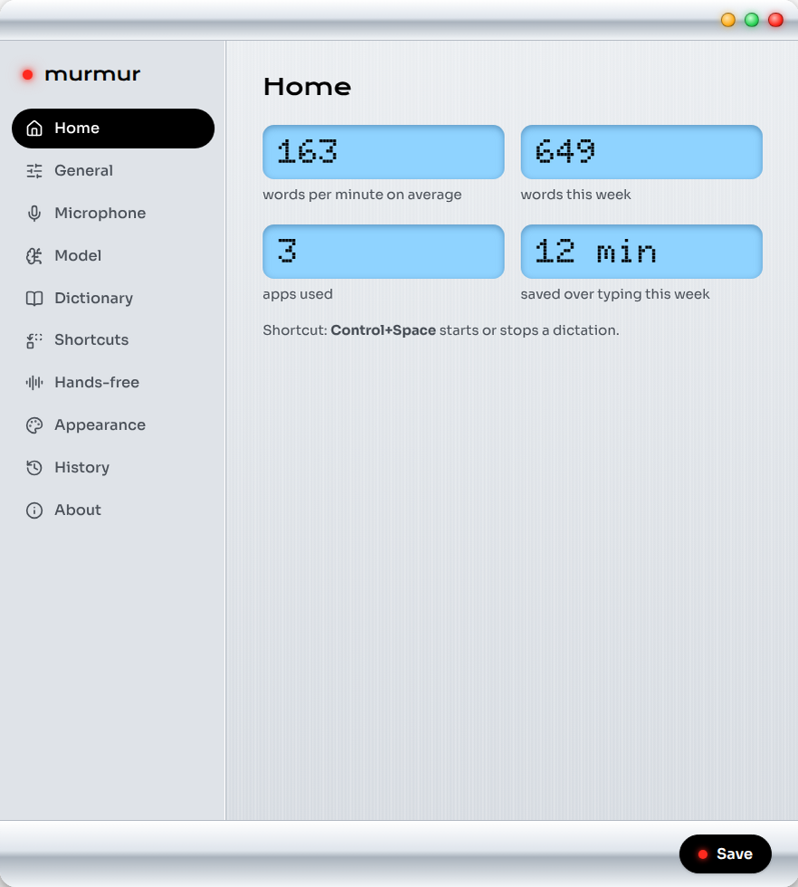
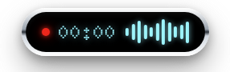
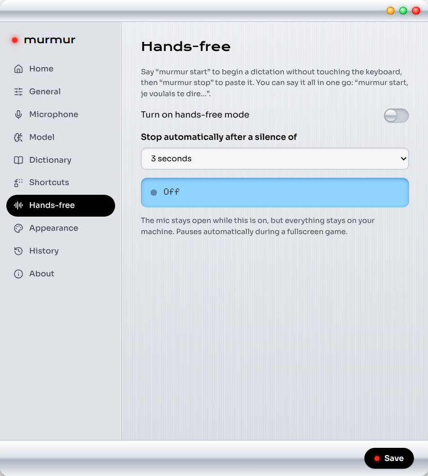
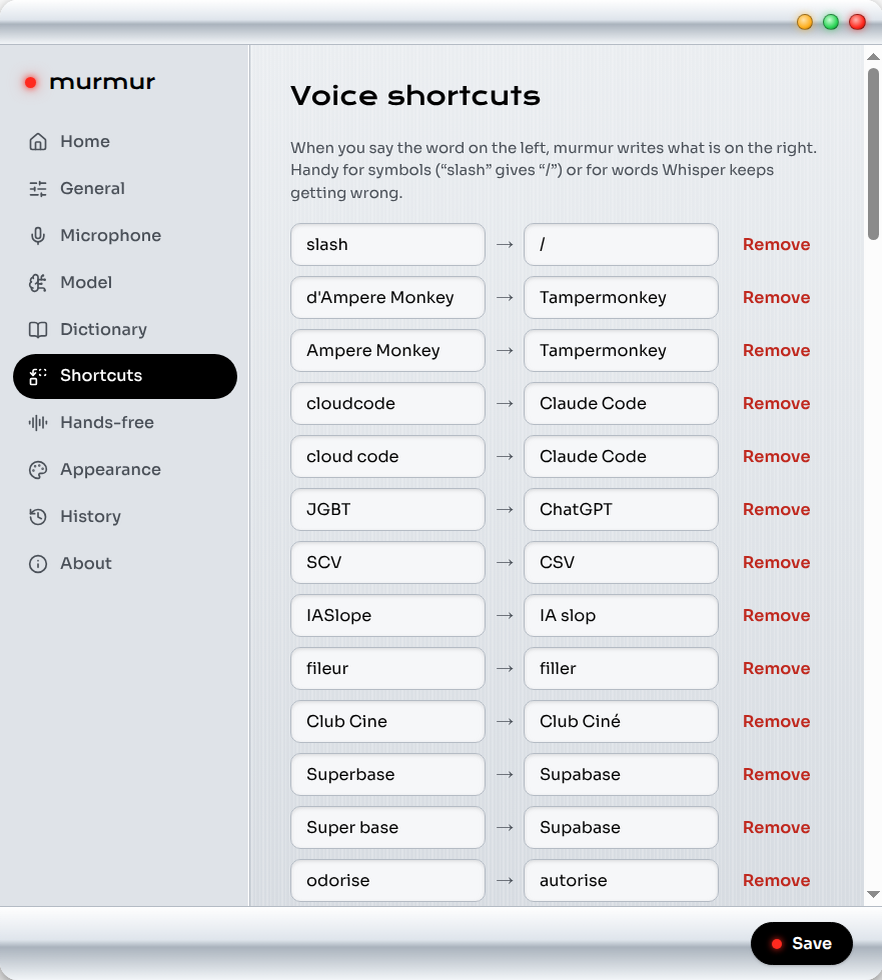

<div align="center">



# murmur

Private, fully local voice dictation for French mixed with English.

**English** | [Français](README.fr.md)

[](../../releases/latest)
[](../../releases/latest)
[](#on-linux-kde-plasma)

<br />



</div>

<br />

I was tired of typing everything on the keyboard, especially when an English word slips into a French sentence and autocorrect jumps in. So I made murmur: press a shortcut, talk, and the text lands right where you're working. Whisper runs on your own GPU, nothing leaves your machine.

## 🎙️ What's inside

Press `Ctrl+Space` and a small chrome capsule shows up at the bottom of the screen and listens. On its screen you get a red LED, the running time and your voice passing by syllable by syllable, even if you sit a bit far from the mic. Press again and it transcribes and pastes the text where your cursor was.

<div align="center">

</div>

It understands French with English words mixed in and leaves them in English (“il faut update le README avant la deadline”), and you can teach it your own technical terms or names in the dictionary.

murmur is made for people who dictate in French. The interface is available in English, but the dictation itself stays French.

Each dictation ends with a space, so you can chain several in the same message without the sentences sticking together.

> [!TIP]
> If you start talking right as you press the shortcut, turn on Settings → **Microphone** → **Keep the microphone open**. murmur then keeps the last split second in memory, without recording anything, and your first word comes through whole.

## 🗣️ Hands-free mode

No keyboard needed: say “murmur start”, a little beep tells you murmur is listening, then talk. To finish, say “murmur stop”, or just stay quiet for a few seconds, and the text pastes itself. You can also say it all in one go: “murmur start, je voulais te dire…”.

<div align="center">

</div>

Turn it on in Settings → **Hands-free**. An indicator shows live whether murmur hears you, along with the last phrase it understood, handy to check that “murmur start” gets through. The mic stays open while the mode is on, but nothing leaves your machine: a small voice detector runs locally, and only phrases said close to the mic go through Whisper to spot the command. Voices from across the room are ignored, and everything pauses during a fullscreen game.

> [!TIP]
> With a Bluetooth headset, keeping the mic open drops the sound to “phone call” quality. This mode works best with a separate mic (USB or built-in).

## 🔀 Voice shortcuts

You say one word, murmur writes another. Say “slash usage” and you get `/usage`, handy for typing a command without touching the keyboard. It also fixes words Whisper always gets wrong: if it keeps hearing “cloud code”, a shortcut turns it into “Claude Code”.

<div align="center">

</div>

Everything lives in Settings → **Shortcuts**: one row per shortcut, what you say on the left, what gets written on the right.

## 🏠 A home screen that keeps count

Average speed, words dictated this week, apps used, time saved over typing: all of it is worked out from your dictation history, stored locally, and shown on small LCD screens.

The rest of the settings opens with a right-click on the system tray icon → **Settings**: keyboard shortcut, mic choice, Whisper model, personal dictionary, pill position, its screen color and dictation history.

## 🌍 In English or in French

The interface comes in English and French. By default murmur follows your system language, and you can force it in Settings → **General** → **Interface language**. Only the menus and labels change, the dictation stays French.

## 📥 Installation

1. Download `murmur-Setup-x.x.x.exe` from the [releases page](../../releases/latest).
2. Double-click it and follow the installer, it creates the shortcut on your Desktop and in the Start menu.
3. On first launch, murmur downloads the Whisper model (1.6 GB) and the pill shows how far along it is. Once it hits 100%, you're set with `Ctrl+Space`.

> [!NOTE]
> The first time, Windows will probably show a blue “Windows protected your PC” window. It does that with every small app it doesn't know yet. Click “More info”, then “Run anyway”.

> [!WARNING]
> You need an NVIDIA GPU (CUDA). Without one, transcription can't run.

### On Linux (KDE Plasma)

No installer yet: murmur is built from source (see below) with `pnpm build:linux`. You need KDE Plasma 6 and these tools:

- `wl-clipboard` for the clipboard, `ydotool` to paste the text (run `systemctl --user enable --now ydotool`), `kdotool` to know which app is in front
- `ffmpeg` and the CUDA Toolkit

The shortcut is registered in KDE's global shortcuts: you'll find it in System Settings → Shortcuts → murmur. In a terminal, murmur pastes with `Ctrl+Shift+V` instead of `Ctrl+V`.

## 🔄 Updates

On Windows, when I ship a new version, murmur downloads it in the background and offers to restart to install it. If you say no, it installs itself on the next launch. On Linux there are no automatic updates: rebuild from source.

## 🔒 What about your data?

Everything runs locally: audio never leaves your machine, transcription happens on your GPU through [whisper.cpp](https://github.com/ggml-org/whisper.cpp), and your dictation history stays in a file on your disk (`history.json`). No server of mine sits in between, the only connection is the model download from Hugging Face on first launch.

With hands-free mode on, murmur also keeps the last 500 phrases that sound like “murmur start” or “murmur stop”, in `voice-commands.json`. They help see how Whisper hears your commands to improve recognition. Nothing else you say is ever stored.

All of this lives in `%APPDATA%\murmur` on Windows and `~/.config/murmur` on Linux, and you can delete those files whenever you want.

## 🤔 Troubleshooting

<details>
<summary><b>The mic doesn't work</b></summary>
<br />
On Windows, check in Settings → Privacy & security → Microphone that desktop apps are allowed to use the mic. Then in murmur's Settings → Microphone, click “Detect available microphones” and pick the right one.
</details>

<details>
<summary><b>My Bluetooth headset disconnects during dictation</b></summary>
<br />
The system switches the headset from the audio profile (A2DP) to the hands-free profile (HFP) as soon as an app asks for the mic, and some headsets handle that switch badly. Pick another mic in Settings → Microphone.
</details>

<details>
<summary><b>The pill shows “ERROR” right after startup</b></summary>
<br />
The GPU driver isn't always ready right away, so the transcription engine fails to start. murmur retries on its own for about thirty seconds. Otherwise, right-click the system tray icon → “Retry starting the engine”. The log is in <code>logs/main.log</code>, inside the data folder.
</details>

<details>
<summary><b>Ctrl+Space does nothing while I'm gaming</b></summary>
<br />
That's on purpose: when a game (or any app) is fullscreen, murmur leaves the shortcut to it so a dictation doesn't start by accident. You can turn this off in Settings → General.
</details>

<details>
<summary><b>Nothing gets pasted in the active app</b></summary>
<br />
On Windows, apps running as administrator refuse keyboard input from a normal program. Run murmur as administrator too in that case. On Linux, check that <code>ydotool</code> is running (<code>systemctl --user status ydotool</code>).
</details>

<details>
<summary><b>The icon disappeared from the system tray</b></summary>
<br />
On Windows, it's probably hiding behind the <code>^</code> arrow next to the clock. Drag it onto the taskbar to keep it visible.
</details>

---

<details>
<summary>🛠️ <b>Hacking on the code</b></summary>

<br />

Electron, electron-vite and strict TypeScript. Node 24+ and pnpm 10+.

### Requirements

- NVIDIA GPU, CUDA Toolkit 12.8+
- CMake and Visual Studio 2022 Build Tools (“Desktop development with C++” workload) on Windows, CMake, Ninja and GCC on Linux
- git and ffmpeg in your PATH

### Commands

```bash
pnpm install
./scripts/setup-whisper.ps1                          # clones and builds whisper.cpp with CUDA (Linux: ./scripts/setup-whisper.sh)
./scripts/download-model.ps1 -Model large-v3-turbo   # Linux: ./scripts/download-model.sh large-v3-turbo
pnpm dev                                             # development mode
pnpm typecheck
pnpm lint
pnpm build:win                                       # builds the installer in dist/
pnpm build:linux                                     # builds dist/linux-unpacked
node scripts/render-icons.mjs                        # regenerates the icons from resources/icons/*.svg
```

To ship a version: bump `version` in `package.json`, run `pnpm build:win`, then attach the three files from `dist/` to a GitHub release (the `.exe` installer, its `.blockmap` and `latest.yml`). If one is missing, auto-update won't see the new version.

To refresh the README screenshots: pick the interface language in settings, then run `MURMUR_SCREENSHOT=docs/en pnpm dev` (or `docs/fr`). The app takes pictures of its own windows (Home, Shortcuts, Hands-free, pill) with a fake mic, saves the PNGs in that folder, then quits.

| Folder                  | Role                                                                  |
| ----------------------- | --------------------------------------------------------------------- |
| `src/main`              | system tray, global shortcut, whisper-server engine, history, updates |
| `src/preload`           | bridges between the app and each window                               |
| `src/renderer/recorder` | mic capture, voice level, hands-free mode (hidden window)             |
| `src/renderer/overlay`  | the floating pill                                                     |
| `src/renderer/settings` | the Settings window                                                   |
| `src/shared`            | types, IPC channels and the interface text in English and French      |
| `resources/icons`       | SVG sources of the app and tray icons                                 |
| `site`                  | the landing page (Vite + TypeScript)                                  |
| `whisper-engine`        | built whisper.cpp + models (generated, not versioned)                 |
| `scripts`               | whisper.cpp build, model download, icon rendering                     |

</details>

## 🔏 Code signing policy

Free code signing provided by [SignPath.io](https://about.signpath.io), certificate by [SignPath Foundation](https://signpath.org).

- Committers and reviewers: [qyrn](https://github.com/qyrn)
- Approvers: [qyrn](https://github.com/qyrn)

Every Windows installer is built from this repository by [GitHub Actions](.github/workflows/release.yml) and each signing request is approved by hand.

Privacy: this program will not transfer any information to other networked systems unless specifically requested by the user or the person installing or operating it. murmur only goes online to download the Whisper model from Hugging Face on first launch and, on Windows, to check GitHub for a new version. Your voice and your text never leave your machine.

## 📄 License

[MIT](LICENSE)
